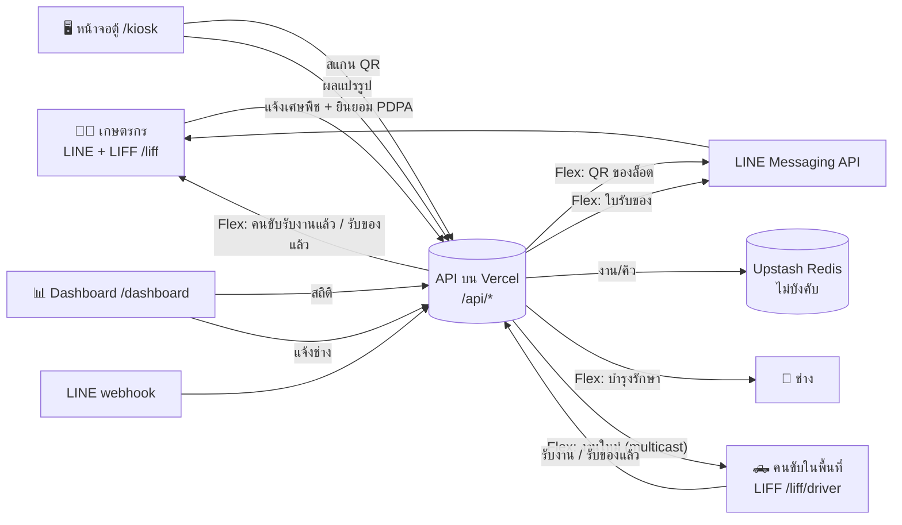
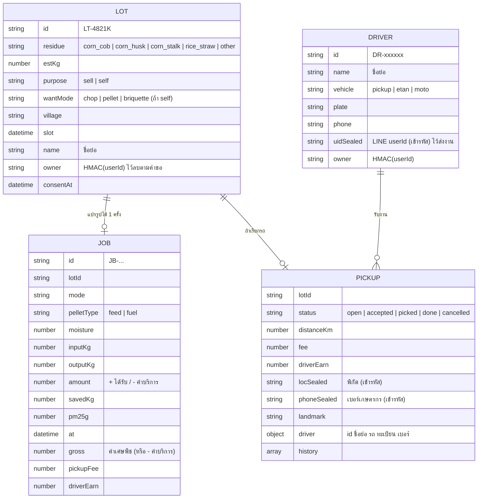

# SRS: ระบบซอฟต์แวร์ตู้แปรรูปเศษวัสดุเกษตร "ไร่ไม่เผา"

Software Requirements Specification · ฉบับ 0.2 (30 ต.ค. 2569) · เพิ่มระบบราคารับซื้อและระบบรับของถึงที่แบบ Grab · รายวิชา 2302103 Sustainable and Responsible Entrepreneurship

> **สถานะ:** ✅ = ทำแล้วในต้นแบบ (`web/`) · 🔲 = ระบบจริงในอนาคต (นอกขอบเขต Expo)
> **ลำดับความสำคัญ:** M = Must, S = Should, C = Could

---

## 1. บทนำ

### 1.1 วัตถุประสงค์
เอกสารนี้กำหนดความต้องการของซอฟต์แวร์ที่ทำงานคู่กับตู้แปรรูป "ไร่ไม่เผา" ได้แก่ LINE Official Account + LIFF (ฝั่งเกษตรกร), หน้าจอสัมผัสหน้าตู้, Dashboard ผลกระทบ และ API กลาง เพื่อใช้พัฒนาต้นแบบสำหรับงาน Sustainability & Social Responsibility Innovation Expo (14 พ.ย. 2569) และเป็นฐานต่อยอดเป็นระบบจริง

### 1.2 ปัญหาและแนวคิด
เกษตรกรในเชียงรายเผาเศษพืช (ซัง/เปลือก/ต้นข้าวโพด ฟางข้าว) เพราะเป็นวิธีที่ถูกและเร็วที่สุด ต้นทุนจึงตกไปอยู่กับสังคมในรูปของฝุ่น PM2.5 (negative externality) "ไร่ไม่เผา" ทำให้เศษพืช**มีราคา** ด้วยตู้ 3 in 1 (สับ / อัดเม็ด / อัดแท่ง) และระบบซอฟต์แวร์ที่บันทึกน้ำหนัก จ่ายเงิน และวัดผลกระทบได้โปร่งใส

### 1.3 ขอบเขต
**ในขอบเขต (ต้นแบบ):** LINE OA + LIFF, ตารางราคารับซื้อ + เครื่องคิดเงิน, **ระบบรับของถึงที่แบบ Grab (คนในพื้นที่สมัครเป็นคนขับ)**, หน้าจอตู้จำลองบนแท็บเล็ต, Dashboard, API บน Vercel, ข้อความ LINE (QR ล็อต, ใบรับของ, งานรับของ, แจ้งช่าง), PDPA
**นอกขอบเขต:** เชื่อมต่อฮาร์ดแวร์จริง (เซนเซอร์ความชื้น ตาชั่ง กล้อง มอเตอร์ ลิ้นสลับทาง) ส่วนนี้ใช้การจำลองในซอฟต์แวร์ และกำหนด interface ไว้ในหัวข้อ 6.3, ระบบชำระเงินจริง, ระบบหลายตู้/หลายชุมชน

### 1.4 นิยาม
| คำ | ความหมาย |
|---|---|
| ล็อต (Lot) | เศษพืชหนึ่งชุดที่เกษตรกรแจ้งนำมาแปรรูปหนึ่งครั้ง มีรหัส เช่น `LT-4821K` |
| งาน (Job) | การแปรรูปหนึ่งครั้งที่ตู้ ผลลัพธ์คือใบรับของ |
| LIFF | LINE Front-end Framework: หน้าเว็บที่เปิดในแอป LINE และรู้ว่าใครเป็นผู้ใช้ |
| Push message | ข้อความที่ระบบส่งเข้าแชต LINE ของผู้ใช้เอง (มีโควตาต่อเดือน) |
| Flex message | ข้อความ LINE แบบการ์ด (มีรูป ตาราง ปุ่ม) |
| โหมดขาย / รับกลับเอง | ขายให้ไร่ไม่เผา = เกษตรกรได้เงิน / แปรรูปแล้วรับกลับไปใช้ = เกษตรกรจ่ายค่าบริการ |
| A / B / C | รหัสโหมด: **A = อัดเม็ด** (เขียว), **B = อัดแท่ง** (ส้ม), **C = สับ** (ฟ้า) ใช้ตรงกันทั้งโปสเตอร์ โมเดล 3D เว็บ และ LINE |
| งานรับของ (Pickup) | คำขอให้รถไปรับเศษพืชถึงไร่ ผูกกับล็อต 1:1 สถานะ open → accepted → picked → done |
| คนขับ (Driver) | คนในพื้นที่ที่มีรถ สมัครผ่าน LINE กดรับงานแบบใครก่อนได้ก่อน และได้ค่าจ้างตามระยะทาง + น้ำหนัก |

---

## 2. ภาพรวมระบบ

### 2.1 กลุ่มผู้ใช้
| ผู้ใช้ | ใช้ผ่าน | ต้องการ |
|---|---|---|
| เกษตรกร (เจ้าของวัตถุดิบ) | LINE OA + LIFF | ดูราคา คำนวณรายได้ แจ้งขาย เลือกนำมาเองหรือเรียกรถ รับ QR ติดตามสถานะรถ รับใบรับของ ใช้สิทธิ์ PDPA |
| คนขับในพื้นที่ | LINE OA + LIFF `/liff/driver` | สมัคร รับแจ้งงานใหม่ ดูงานใกล้ตัว กดรับงาน นำทาง โทรหาเจ้าของ ส่งที่ตู้ ดูรายได้ |
| พนักงานหน้าตู้ | หน้าจอสัมผัส | สแกน QR เลือกโหมด ยืนยันการทำความสะอาด หยุดฉุกเฉิน |
| ผู้รับซื้อ (ฟาร์มเห็ด สหกรณ์โคนม โรงอบ) | (อนาคต) | ส่งคำสั่งซื้อ ระบบเลือกโหมดตามคำสั่งซื้อ |
| ผู้ดูแลชุมชน / ผู้เยี่ยมชม | Dashboard | ดูผลกระทบ คิว สถานะตู้ |
| ช่างซ่อมบำรุง | LINE | รับแจ้งเตือนรอบบำรุงรักษา |

### 2.2 สภาพแวดล้อม
- เว็บ: React 18 + Vite, รองรับมือถือ (กว้าง ≥ 360 px) และแท็บเล็ตแนวนอน
- API: Vercel Functions (Node.js, Web Request/Response)
- LINE: Messaging API channel + LINE Login channel (LIFF) **ภายใต้ Provider เดียวกัน** เพื่อให้ userId ตรงกัน
- ฐานข้อมูล: Upstash Redis (free tier) ถ้าไม่ตั้งค่า จะเก็บในหน่วยความจำและ localStorage แทน
- โมเดล 3D: glTF (`.glb`) export จาก Blender 5.2 แสดงด้วย `<model-viewer>`

### 2.3 ข้อจำกัดและสมมติฐาน
- งบ 1,000 บาท เบิกได้เฉพาะเครื่องเขียน/งานพิมพ์ จึงต้องใช้บริการฟรีทั้งหมด (Vercel Hobby, LINE OA ฟรี, Upstash free)
- LINE OA แผนฟรีมีโควตา push message ต่อเดือนจำกัด (ตรวจตัวเลขล่าสุดใน OA Manager) ส่วน reply message (ตอบกลับ webhook) ไม่นับโควตา
- **ตัวเลขราคา ผลผลิต และค่า PM2.5 ต่อ กก. เป็นค่าสมมติ** อยู่ในไฟล์เดียว `web/shared/rules.js` เพื่อแก้ง่าย และต้องติดป้าย "ค่าประมาณ" ทุกจุดที่แสดง

---

## 3. Functional Requirements

### 3.1 LINE OA + LIFF (เกษตรกร) — หน้า `/liff`
| ID | ความต้องการ | Pri | สถานะ |
|---|---|---|---|
| FR-L01 | ระบบต้องยืนยันตัวตนด้วย LINE Login (LIFF) และส่ง ID token ให้ API ตรวจสอบกับ LINE ก่อนสร้างล็อต | M | ✅ |
| FR-L02 | ก่อนใช้งานครั้งแรก ต้องแสดงหน้าขอความยินยอมที่**แยกจากเงื่อนไขอื่น** ระบุข้อมูลที่เก็บ วัตถุประสงค์ และสิทธิ์ ปุ่มยินยอมกดได้เมื่อติ๊กยอมรับเท่านั้น (PDPA ม.19) | M | ✅ |
| FR-L03 | เกษตรกรแจ้งเศษพืชได้: ชนิด 4 แบบ (ต้น/ซัง/เปลือกข้าวโพด, ฟางและตอซังข้าว, ใบอ้อย, กิ่งไม้ตัดแต่งสวน), น้ำหนักประมาณ (1–5000 กก.), หมู่บ้าน, ต้องการขาย/รับกลับเอง (ถ้ารับกลับเองเลือกโหมด A/B/C), เวลานัด | M | ✅ |
| FR-L13 | แท็บ/หน้า **ราคารับซื้อ**: ราคาต่อ กก. ตามชนิด, ส่วนลดตามความชื้น, ค่าบริการรับกลับเอง, สูตรค่ารถ + **เครื่องคิดเงิน** (ชนิด น้ำหนัก ความชื้น ระยะทาง → ยอดสุทธิ) | M | ✅ `/prices`, `/liff?tab=price` |
| FR-L14 | ตอนแจ้งขาย แสดง**ใบเสนอราคาโดยประมาณ** (ค่าเศษพืช − ค่ารถ = สุทธิ) ทันทีที่กรอก และส่งซ้ำในข้อความ LINE | M | ✅ |
| FR-L15 | เลือกวิธีส่ง: **นำมาเองที่ตู้** หรือ **เรียกรถไปรับ** (ต้องแชร์ตำแหน่ง + เบอร์โทร + จุดสังเกต, รัศมีไม่เกิน 30 กม.) | M | ✅ |
| FR-L16 | แท็บ "ล็อตของฉัน" แสดงสถานะรถแบบสด (หาคนขับ / คนขับรับงาน ชื่อ-ทะเบียน / รับของแล้ว / จ่ายเงินแล้ว) | S | ✅ |
| FR-L04 | เลือกเวลานัดจากช่วงเวลาที่ตู้เปิด (จ.–ส. 4 รอบ/วัน) | S | ✅ |
| FR-L05 | สร้างล็อตแล้วต้องส่ง **Flex message มีรูป QR** เข้าแชต LINE ของเกษตรกรอัตโนมัติ และแสดง QR บนหน้าจอด้วย | M | ✅ |
| FR-L06 | QR ต้องเข้ารหัส (ไม่มี LINE userId ที่อ่านได้) และปลอมแปลงไม่ได้ | M | ✅ AES-256-GCM |
| FR-L07 | หน้า "ล็อตของฉัน" แสดงล็อตและ QR ย้อนหลัง | S | ✅ (เก็บในเครื่อง) |
| FR-L08 | หน้า "สิทธิ์ของฉัน": ถอนความยินยอมและขอลบข้อมูลได้ง่ายเท่ากับตอนให้ความยินยอม | M | ✅ `DELETE /api/me` |
| FR-L09 | Rich menu 4 ปุ่ม: ขาย/เรียกรถรับ, ราคารับซื้อ, ล็อตของฉัน, ขับรถรับของ | S | ✅ รูปที่ `docs/line/richmenu.png` |
| FR-L10 | Webhook ตอบข้อความอัตโนมัติ: ทักทายเมื่อเพิ่มเพื่อน, "วิธีใช้", **"ราคา" → Flex ตารางราคา**, "คนขับ" → ลิงก์สมัคร พร้อม quick reply | S | ✅ |
| FR-L11 | เปิดนอก LINE (ไม่มี LIFF ID) ต้องใช้งานได้ใน **โหมดทดลอง** โดยไม่ส่งข้อความ LINE | M | ✅ |
| FR-L12 | ประวัติรายได้รวมจาก server | C | 🔲 |

### 3.1b ระบบรับของถึงที่ (แบบ Grab) — หน้า `/liff/driver`
| ID | ความต้องการ | Pri | สถานะ |
|---|---|---|---|
| FR-P01 | คนในพื้นที่สมัครเป็นคนขับผ่าน LINE: ประเภทรถ (กระบะ / อีแต๋น / มอเตอร์ไซค์พ่วง), ทะเบียน, เบอร์โทร, หมู่บ้าน + ยินยอม PDPA | M | ✅ |
| FR-P02 | เมื่อมีคำขอรถใหม่ ระบบส่ง Flex "งานรับของใหม่" ให้คนขับที่ใช้ LINE (multicast สูงสุด 50 คน) แสดงหมู่บ้าน น้ำหนัก ระยะทาง และค่าจ้าง | M | ✅ |
| FR-P03 | หน้า "งานใกล้ฉัน" เรียงตามระยะจากตำแหน่งคนขับ **ก่อนรับงานเห็นเฉพาะพิกัดคร่าว ๆ (~1 กม.) ไม่เห็นเบอร์โทร/QR** | M | ✅ |
| FR-P04 | กดรับงานแบบใครก่อนได้ก่อน ต้องกันไม่ให้ 2 คนรับงานเดียวกัน (atomic lock) | M | ✅ `SET NX` |
| FR-P05 | หลังรับงาน คนขับเห็นพิกัดจริง (ปุ่มนำทาง Google Maps), จุดสังเกต, เบอร์เกษตรกร; เกษตรกรได้ Flex "มีคนขับรับงานแล้ว" พร้อมชื่อ ทะเบียน ปุ่มโทร | M | ✅ |
| FR-P06 | คนขับกด "รับของแล้ว" → แจ้งเกษตรกร; ยกเลิกได้เฉพาะก่อนรับของ (งานกลับไปเป็น open และแจ้งเกษตรกร) | M | ✅ |
| FR-P07 | ถึงตู้: คนขับแสดง QR ของล็อตในหน้าคนขับให้ตู้สแกน หน้าจอตู้แสดง "ส่งโดย …" | M | ✅ |
| FR-P08 | ชั่งเสร็จ: หักค่ารถจากยอดเกษตรกร, คนขับได้ 90% (ไร่ไม่เผาได้ 10% = รายได้แพลตฟอร์ม/Brokerage fee) และได้ Flex "ส่งของสำเร็จ" | M | ✅ |
| FR-P09 | เรียกรถแล้วแต่เกษตรกรนำมาเอง → ไม่คิดค่ารถ และปิดงานรับของอัตโนมัติ | S | ✅ |
| FR-P10 | หน้า "ประวัติ" ของคนขับ: งานที่ทำและรายได้สะสม | S | ✅ |
| FR-P11 | ประกันภัยสินค้า/คนขับ, ให้คะแนนคนขับ, จ่ายเงินผ่านพร้อมเพย์อัตโนมัติ | C | 🔲 |

### 3.2 หน้าจอตู้ — หน้า `/kiosk`
| ID | ความต้องการ | Pri | สถานะ |
|---|---|---|---|
| FR-K01 | สแกน QR ด้วยกล้อง แล้วให้ API ถอดรหัสล็อตและคืนน้ำหนักที่ชั่งตอนรับของ | M | ✅ |
| FR-K02 | ปุ่ม "ล็อตทดลอง" สำหรับเดโมโดยไม่ต้องมี LINE | M | ✅ |
| FR-K03 | วัดความชื้นที่ช่องป้อน ถ้า > 20% ต้อง**ไม่รับวัตถุดิบ** และแนะนำให้นำไปตาก (API ปฏิเสธซ้ำ 422) | M | ✅ (จำลองเซนเซอร์) |
| FR-K04 | ล็อตแบบ "ขาย": ระบบเลือกโหมดให้ตามคำสั่งซื้อ (ล็อกปุ่มอื่น) · แบบ "รับกลับเอง": เลือกโหมดได้ ปุ่มแสดงรหัส A/B/C + สีตามโปสเตอร์ | M | ✅ (คำสั่งซื้อจำลอง) |
| FR-K05 | โหมดอัดเม็ดต้องเลือกแม่พิมพ์: อาหารสัตว์ (เล็ก) / เชื้อเพลิง (ใหญ่) | M | ✅ |
| FR-K06 | ถ้างานก่อนหน้าเป็นเชื้อเพลิงและงานนี้เป็นอาหารสัตว์ ต้องบังคับขั้น "เดินเครื่องเปล่า + ทำความสะอาด" ให้พนักงานยืนยันก่อน | M | ✅ |
| FR-K07 | โหมดอัดแท่งต้องแสดงขั้นอุ่นขดลวด 10–15 นาทีก่อนเริ่ม | S | ✅ (เร่งเวลา) |
| FR-K08 | แสดงขั้นตอนและแถบความคืบหน้า: ถ่ายรูป → สับ → ลิ้นสลับทาง → อัด → ชั่ง | S | ✅ |
| FR-K09 | ปุ่ม**หยุดฉุกเฉิน**บนจอ กดได้ทุกขั้นตอน และหยุดกระบวนการทันที | M | ✅ |
| FR-K10 | เมื่อเสร็จ ส่งผลไป API แล้ว API คำนวณยอดเงิน บันทึกงาน และ**ส่งใบรับของ (Flex) เข้า LINE ของเจ้าของล็อต** พร้อมรูป น้ำหนักก่อน/หลัง ความชื้น ยอดเงิน และปริมาณที่ลดการเผา | M | ✅ |
| FR-K11 | ล็อตเดียวแปรรูปซ้ำไม่ได้ (409) | M | ✅ |
| FR-K12 | น้ำหนักสินค้าต้องไม่เกินน้ำหนักวัตถุดิบ (ป้องกันข้อมูลผิด) | M | ✅ |
| FR-K13 | กลับหน้าสแกนอัตโนมัติหลังเสร็จ 30 วินาที | C | ✅ |
| FR-K14 | ถ่ายรูปจริงจากกล้องหน้าตู้และแนบในใบรับของ | S | 🔲 (ต้นแบบใช้ภาพสินค้าจาก render) |

### 3.3 Dashboard — หน้า `/dashboard`
| ID | ความต้องการ | Pri | สถานะ |
|---|---|---|---|
| FR-D01 | แสดง KPI: เศษพืชที่ไม่ถูกเผา (กก.), PM2.5 ที่ลดได้ (ประมาณ), รายได้ที่จ่ายเกษตรกร, **รายได้คนขับในชุมชน** | M | ✅ |
| FR-D02 | กราฟผลผลิตตามโหมด และหมู่บ้านที่ลดการเผามากที่สุด | S | ✅ |
| FR-D03 | ตารางงานล่าสุด แสดงชื่อแบบย่อเท่านั้น ("สมชาย ใ.") | M | ✅ |
| FR-D04 | คิววันนี้จากล็อตที่จองไว้ | S | ✅ (ต้องเปิด Upstash จึงจะแชร์ข้ามเครื่อง) |
| FR-D05 | สถานะตู้: ชั่วโมงทำงานเทียบรอบบำรุงรักษา 200 ชม. เตือนเมื่อถึง 90% | S | ✅ |
| FR-D06 | ปุ่ม "แจ้งช่างผ่าน LINE" ส่ง Flex รายการตรวจ (ใบมีด ลูกกลิ้ง แม่พิมพ์ เกลียวอัด ถุงฝุ่น) | S | ✅ |
| FR-D07 | สวิตช์รวม/ไม่รวมข้อมูลจำลอง และติดป้ายเมื่อมีข้อมูลจำลอง | M | ✅ |
| FR-D08 | อัปเดตอัตโนมัติทุก 5 วินาที | S | ✅ |

### 3.4 หน้าแรก — `/`
| ID | ความต้องการ | Pri | สถานะ |
|---|---|---|---|
| FR-H01 | โมเดล 3D หมุนได้บนมือถือ + แถบเลื่อน "ประกอบ ↔ แยกชิ้นส่วน" | S | ✅ |
| FR-H02 | อธิบาย 3 โหมด ขั้นตอนใช้งาน และหมายเหตุความโปร่งใสของตัวเลข | M | ✅ |
| FR-H03 | หน้านโยบายความเป็นส่วนตัว `/privacy` | M | ✅ |

---

## 4. Non-functional Requirements
| ID | หมวด | ความต้องการ | สถานะ |
|---|---|---|---|
| NFR-01 | ใช้งานง่าย | ภาษาไทยทั้งหมด ปุ่มบนจอตู้ใหญ่ (สูง ≥ 110 px) อ่านได้จากระยะ 1 เมตร | ✅ |
| NFR-02 | รองรับอุปกรณ์ | มือถือกว้าง 360 px ขึ้นไป ไม่มี scroll แนวนอน · แท็บเล็ตแนวนอน | ✅ |
| NFR-03 | ความเป็นส่วนตัว | ไม่เก็บ LINE userId ตรง ๆ ในฐานข้อมูล (เก็บค่าแฮช HMAC), Dashboard/stats ไม่มีข้อมูลระบุตัวตน | ✅ มี test |
| NFR-04 | ความปลอดภัย | Secret อยู่ใน env ของ Vercel เท่านั้น ห้าม commit · ตรวจลายเซ็น webhook (`x-line-signature`) · ตรวจ ID token กับ LINE ทุกครั้ง | ✅ |
| NFR-05 | ความถูกต้อง | ยอดเงินคำนวณที่ server เท่านั้น (ไม่เชื่อค่าจากหน้าจอตู้) | ✅ |
| NFR-06 | ความทนทาน | ถ้า LINE ส่งไม่สำเร็จ งานยังบันทึกได้ และหน้าจอแจ้งสาเหตุ | ✅ |
| NFR-07 | ความโปร่งใส | ตัวเลขสมมติต้องมีป้าย "ค่าประมาณ/ข้อมูลจำลอง" | ✅ |
| NFR-08 | ประสิทธิภาพ | หน้าแรกแสดงผลได้ก่อนโมเดล 3D โหลดเสร็จ (lazy load) | ✅ |
| NFR-09 | ค่าใช้จ่าย | 0 บาท/เดือนในช่วงต้นแบบ | ✅ |

---

## 5. ข้อมูล (Data Model)

- **QR token** = AES-256-GCM(ข้อมูลล็อต + LINE userId + ชื่อเต็ม) อยู่กับเกษตรกรเท่านั้น
- **น้ำหนักรับเข้า** (ต้นแบบ) = น้ำหนักที่แจ้ง ±8% แบบคงที่ต่อล็อต ส่วนระบบจริงจะอ่านจากตาชั่งจุดรับของ

---

## 6. Interfaces

### 6.1 REST API (`web/api/`)
| Method | Path | ใช้โดย | หน้าที่ |
|---|---|---|---|
| POST | `/api/lots` | LIFF | สร้างล็อต (ต้องมี `idToken` หรือ `demo:true`, และ `consentAt`) → `{lot, token, pushed}` + push QR |
| GET | `/api/lots` | — | รายการล็อต (ชื่อย่อ) |
| POST | `/api/scan` | ตู้ | `{token}` → ข้อมูลล็อต + `receivedKg` |
| POST | `/api/receipt` | ตู้ | `{token, mode, pelletType, moisture, outputKg}` → บันทึกงาน + push ใบรับของ |
| GET | `/api/stats` | Dashboard | งาน + ล็อต (ไม่มี owner/userId) |
| DELETE | `/api/me` | LIFF | `{idToken}` → ลบล็อต/งานของผู้ใช้ |
| POST | `/api/maintenance` | Dashboard | push แจ้งช่าง (`TECH_USER_ID`) |
| GET | `/api/qr?t=` | LINE | รูป PNG ของ QR (เฉพาะ token ที่ถูกต้อง) |
| POST | `/api/webhook` | LINE | รับ event, ตรวจลายเซ็น, ตอบกลับ |
| POST | `/api/drivers` | LIFF คนขับ | สมัครคนขับ → `driverToken` |
| GET | `/api/drivers?token=` | LIFF คนขับ | ข้อมูลตัวเอง + งานที่รับ + รายได้สะสม |
| GET | `/api/pickups?lat=&lng=` | LIFF คนขับ | งานที่ยังไม่มีคนรับ (พิกัดคร่าว ๆ) |
| GET | `/api/pickups?lot=` | LIFF เกษตรกร | สถานะรถของล็อต |
| POST | `/api/pickups` | LIFF คนขับ | `{action: accept \| picked \| release}` + แจ้ง LINE |

### 6.2 ข้อความ LINE
1. **QR ของล็อต** (Flex): รูป QR, ชนิด, น้ำหนัก, วัตถุประสงค์, เวลานัด, ปุ่มเปิด LIFF
2. **ใบรับของ** (Flex): รูปสินค้า, โหมด, น้ำหนักก่อน/หลัง, ความชื้น, ยอดเงิน, กล่อง "คุณช่วยลดการเผาได้ X กก. ≈ PM2.5 Y กรัม"
3. **แจ้งช่าง** (Flex): ชั่วโมงทำงาน + checklist
4. **ตอบอัตโนมัติ** (text / Flex ตารางราคา + quick reply)
5. **งานรับของใหม่** → คนขับ (multicast) · **คนขับรับงานแล้ว** / **รับของแล้ว** → เกษตรกร · **รายละเอียดงาน** + **ส่งของสำเร็จ (ค่าจ้าง)** → คนขับ

> ⚠️ โควตา push ของ LINE OA แผนฟรีนับตามจำนวนผู้รับ การแจ้งงานใหม่ถึงคนขับ 10 คน = 10 ข้อความ ช่วงเดโมควรมีคนขับที่ใช้ LINE จริงไม่เกิน 2–3 คน

### 6.3 Hardware interface (อนาคต 🔲)
ตัวควบคุมในตู้ (เช่น ESP32/PLC) ส่งข้อมูลเข้า API แทนการจำลอง:
| สัญญาณ | จาก | ใช้ใน |
|---|---|---|
| `moisture` (%) | เซนเซอร์ความชื้นที่ช่องป้อน | FR-K03 |
| `weight_tray_{chop,pellet,briquette}` (กก.) | load cell ใต้ถาด | FR-K10 |
| `photo_in`, `photo_out` | กล้องหน้าตู้ | FR-K14 |
| `motor_temp` (°C) → ตัดไฟเมื่อร้อนเกิน | เซนเซอร์มอเตอร์ | ความปลอดภัย |
| `lid_open`, `estop` | สวิตช์ฝา/ปุ่มฉุกเฉิน (ตัดไฟด้วยฮาร์ดแวร์ ไม่พึ่งซอฟต์แวร์) | ความปลอดภัย |
| `diverter_position` | มอเตอร์ลิ้นสลับทาง | FR-K04 |
| `run_hours` | ตัวนับชั่วโมง | FR-D05 |

> หลักความปลอดภัย: ปุ่มหยุดฉุกเฉินและสวิตช์ฝาต้อง**ตัดไฟที่วงจรโดยตรง** ปุ่มบนจอเป็นแค่ส่วนเสริม

---

## 7. การทดสอบ / Acceptance
- **Automated:** `cd web && npm test` มี 10 ชุดทดสอบ (รวม flow รับของแบบ Grab: แจ้งคนขับ → กันรับซ้ำ → รับของ → ชั่ง → จ่ายเกษตรกรและคนขับ, และการไม่เปิดเผยพิกัด/เบอร์ก่อนรับงาน) ครอบคลุม FR-L01/02/05/06/08/10, FR-K03/10/11/12, NFR-03/04/05 (จำลอง LINE Platform ไม่ต้องมีบัญชีจริง)
- **ทดสอบมือ (ก่อนวันงาน):**
  1. เพิ่มเพื่อน OA แล้วได้ข้อความทักทาย + quick reply
  2. กดเมนู "แจ้งเศษพืช" → ยินยอม → กรอกฟอร์ม แล้วได้ QR ในแชตภายใน 5 วินาที
  3. สแกน QR ที่ `/kiosk` แล้วเห็นน้ำหนักและความชื้น ล็อตชื้นต้องถูกปฏิเสธ
  4. แปรรูปเสร็จ แล้วได้ใบรับของในแชตพร้อมยอดเงินถูกต้อง
  5. สแกน QR เดิมซ้ำ แล้วต้องขึ้น "ล็อตนี้แปรรูปไปแล้ว"
  6. กด "ถอนความยินยอมและลบข้อมูล" แล้วล็อตหายจาก Dashboard

---

## 8. ความเชื่อมโยงกับเนื้อหารายวิชา
| Module | ปรากฏในระบบ |
|---|---|
| M1 Entrepreneurship | ทำให้ต้นทุนการเผา (externality) กลายเป็นรายได้ / SDG 3, 8, 12, 13 |
| M2 Management | รอบบำรุงรักษา, คิว, บทบาททีม (Timeline) |
| M3 IP Law | ชื่อ/โลโก้ "ไร่ไม่เผา" จดเครื่องหมายการค้าได้, โค้ดและโมเดล 3D มีลิขสิทธิ์ทันทีที่สร้าง |
| M4 PDPA | หน้า consent แยก, ฐานทางกฎหมายรายข้อมูล, สิทธิ์ลบ/ถอน, เข้ารหัส QR, ซ่อนชื่อ |
| M5 TBL | People (รายได้เกษตรกร) · Planet (PM2.5) · Profit (ค่าบริการ/ส่วนต่างราคา) บน Dashboard |
| M7 Critical thinking | ป้าย "ค่าประมาณ" + ต้องอ้างอิงแหล่งข้อมูล |
| M8–9 Digital Business | LINE OA เป็น channel หลัก, platform สองฝั่ง (เกษตรกร ↔ ผู้รับซื้อ) |
| M10 Social Enterprise | Impact metrics วัดได้จริงจากทุกงาน |

---

## ภาคผนวก A: สเปกตัวเครื่อง (สรุปจากเอกสารออกแบบของกลุ่ม)
ขนาด 85 × 180 × 60 ซม. จัดชั้นตามแรงโน้มถ่วง:
| ความสูง | ส่วนประกอบ |
|---|---|
| 140–180 ซม. | ช่องป้อน (ฝา + สวิตช์ตัดไฟ, ตะแกรงกันมือ, แม่เหล็กดักเศษเหล็ก, เซนเซอร์ความชื้น) + หน้าจอสัมผัส/สแกน QR/กล้อง |
| 100–140 ซม. | เครื่องสับ hammer mill ~3 kW, ตะแกรง 2 ขนาด |
| 85–100 ซม. | ลิ้นสลับทาง (มอเตอร์) |
| 30–85 ซม. | ซ้าย: flat die อัดเม็ด (2 ขนาด) · กลาง: ช่องตรง (โหมดสับ) · ขวา: screw press + ขดลวดร้อน + ตัดท่อน |
| 0–30 ซม. | ถาดรับ 3 ช่อง + ตาชั่งใต้ถาด |
| ด้านหลัง | พัดลมดูดฝุ่น + ถุงเก็บฝุ่น, ตู้ควบคุมไฟฟ้า, ช่องระบายความร้อน |

โมเดล 3D ทำตามตารางนี้: `blender/build_model.py`

## ภาคผนวก B: ราคาและค่ารถ (ค่าสมมติ แก้ที่ `web/shared/rules.js`)
| รายการ | ค่า |
|---|---|
| ราคารับซื้อ (฿/กก.) | ข้าวโพด 1.00 · ฟาง/ตอซังข้าว 1.20 · ใบอ้อย 0.80 · กิ่งไม้ผล 1.50 |
| ความชื้น | ≤ 15% ราคาเต็ม · 15–20% ลด 10% · > 20% ไม่รับ |
| ค่าบริการรับกลับเอง (฿/กก.) | A อัดเม็ด 0.80 · B อัดแท่ง 1.00 · C สับ 0.30 |
| ค่ารถรับของ | 20 ฿ + 4 ฿/กม. + 0.10 ฿/กก. (ระยะถนน ≈ เส้นตรง × 1.3) รัศมี 30 กม. คนขับได้ 90% |
| ตัวอย่าง | ขายข้าวโพด 400 กก. ห่าง 5 กม. แห้ง → 400 − ค่ารถ 80 = **รับสุทธิ 320 ฿**, คนขับได้ 72 ฿ |

> ตัวเลขในโปสเตอร์ (เช่นภาพมือถือ) ต้องตรงกับไฟล์นี้ ภาพมือถือใน `blender/textures/phone_line.png` สร้างจากสูตรเดียวกันอัตโนมัติ

## ภาคผนวก C: ประเด็นที่ต้องตอบกรรมการได้
- **อาหารสัตว์:** การผลิตอาหารสัตว์เพื่อขายในไทยอยู่ภายใต้กฎหมายควบคุมคุณภาพอาหารสัตว์ ช่วงแรกจึงควรใช้ในฟาร์มของชุมชนเอง แล้วค่อยขึ้นทะเบียนเมื่อขยาย
- **ข้อจำกัดของตู้:** ทำได้ทีละโหมด (แก้ด้วยระบบคิว) · ถ้าเครื่องสับเสีย ทั้งตู้หยุด (ต้องมีใบมีดสำรอง + แจ้งช่างอัตโนมัติ)
- **ตัวเลขทุกตัวต้องทดสอบจริง:** แก้ได้ที่ไฟล์เดียว `web/shared/rules.js`
- **ระบบรับของ:** คนขับเป็นคนในชุมชน (รายได้เสริม = People) ลดเที่ยวรถเปล่า และเป็น Revenue stream แบบ Brokerage fee (10%) ตามเนื้อหา BMC; ความเสี่ยงคือความปลอดภัยและน้ำหนักบรรทุก แก้ด้วยกำหนดพิกัดรถ ประกัน และคะแนนคนขับ (อนาคต)
